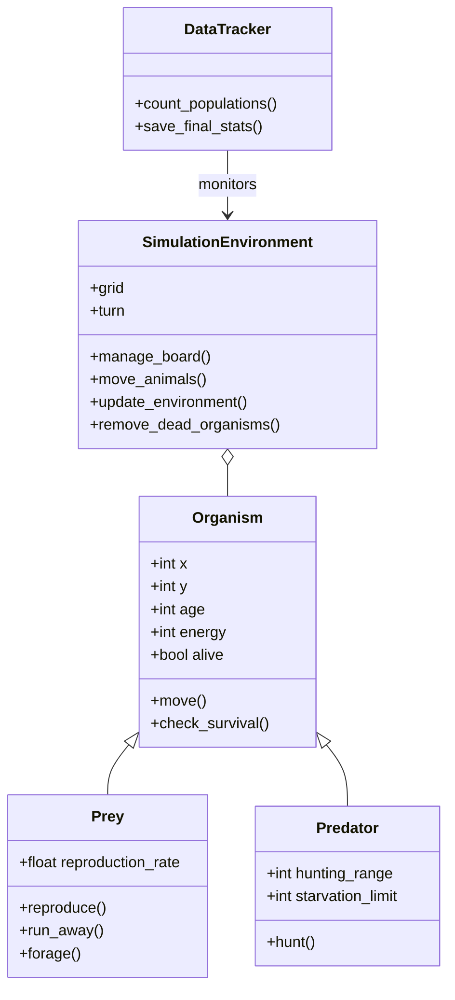

# EcoSim - Object-Oriented Ecosystem Simulator

### Project Title or Name of the Application:
EcoSim - Object-Oriented Ecosystem Simulator

### Section:
9-Potassium

### Group Members:
BALISA, CAGUIOA, PASTRANA

### Date (Proposal Date):
November 5, 2026

### Project Description:

#### Summary

How ecological change affects wildlife populations poses a great challenge to Earth and Environmental Science. EcoSim (Ecosystem Simulator) is an application written in Python that incorporates Object-Oriented Programming to demonstrate interactions between predators and prey, such as wolves and rabbits, through a common grid-based environment.

Scientists, teachers, and data science learners require easy ways of visualizing how factors such as birth rates, initial numbers, and energy depletion rates lead to population crashes and/or population cycles. EcoSim meets this requirement through conducting turn-based simulation of individuals' choices with real-time ecological data.

#### System Components

**1. SimulationEnvironment Class**

This acts as the map or grid. It controls the game board, manages the turn-by-turn clock, moves the animals, updates environmental factors, and removes dead organisms from the map.

**2. Organism Class**

The fundamental base blueprint for life in the system. Every animal inherits these basic traits: an X and Y position on the map, an age tracker, an energy tracker, and a status checking if they are alive or dead. It includes basic functions like moving and checking survival.

**3. Prey Class**

A specialized blueprint that inherits everything from the Organism class but adds specific rabbit traits. It includes a custom reproduction rate and unique behaviors, such as running away from nearby predators and foraging for plants to gain energy.

**4. Predator Class**

A specialized blueprint that inherits everything from the Organism class but adds specific wolf traits. It tracks a hunting range and starvation limits. It includes behaviors like tracking down nearby prey and hunting them to gain energy.

**5. DataTracker Class**

An analysis tool that watches the simulation grid. It counts how many wolves and rabbits are alive during each turn and saves the final stats at the very end.

#### Target Demographics

**High School Science Students:** Need a dynamic, visual tool to experiment with food web imbalances and fulfill Data Literacy goals.

**Biology Instructors:** Need a configurable simulation tool to easily demonstrate ecosystem carrying capacity, population equilibrium, and extinction events during lectures.

#### Class Diagram

The following class diagram shows the classes, their attributes, methods, and relationships in EcoSim.

### Goals:

The long-term goal of EcoSim is to develop an ecosystem simulator that demonstrates how predators and prey interact and how environmental factors affect their populations over time. It aims to help students and teachers understand ecological balance through an interactive simulation.

- **Objective 1:** Implement core OOP principles including Polymorphism (giving rabbits and wolves distinct movement behaviors) and Inheritance (using the Organism base class for shared traits).
- **Objective 2:** Design a robust grid environment where organisms can move, hunt, and forage dynamically across a 2D coordinate system.
- **Objective 3:** Build a data tracking module that successfully exports timeline counts and population statistics for post-simulation analysis.

---

**Technologies Used:**
- Python
- Object-Oriented Programming (OOP)
- GitHub

